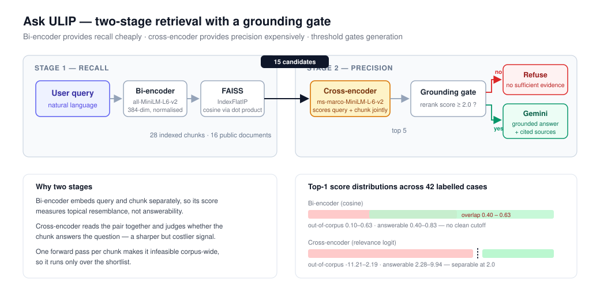

# Ask ULIP — RAG-based Logistics Knowledge Assistant

A retrieval-augmented generation assistant over public ULIP and Indian logistics-policy
material. It answers questions with cited evidence, and refuses questions the corpus
cannot support rather than guessing.

## Problem

ULIP onboarding, use cases and policy information are spread across public releases and
documents. A logistics stakeholder or new team member needs a quick, evidence-backed
explanation without searching every source manually.

The harder problem is knowing when *not* to answer. A naive RAG system will retrieve the
nearest chunk for any question, including questions its corpus cannot answer, and
generate a confident response from irrelevant context. Most of the engineering here
addresses that.

## Architecture



Two-stage retrieval with a grounding gate:

```
query
  │
  ├─► bi-encoder embedding (all-MiniLM-L6-v2)
  │        │
  │        ▼
  │   FAISS IndexFlatIP ──► 15 candidate chunks        [recall, cheap]
  │                              │
  │                              ▼
  └──────────────────► cross-encoder rerank            [precision, expensive]
                       (ms-marco-MiniLM-L-6-v2)
                               │
                               ▼
                      top 5 chunks + relevance score
                               │
                     ┌─────────┴─────────┐
            score < 2.0                score ≥ 2.0
                 │                          │
                 ▼                          ▼
             refuse            Gemini generation with cited sources
```

The bi-encoder embeds query and chunks independently, so its cosine score measures
vector-space proximity, not answerability. The cross-encoder reads each query-chunk pair
together and scores how well the chunk answers the question. Running the cross-encoder
over the whole corpus would cost one forward pass per chunk per query, so it is applied
only to the shortlist the vector search returns.

## Results

Measured on `evaluation/evaluation_set.json` — 42 labelled cases: 32 answerable from the
corpus, 10 deliberately out-of-corpus to test refusal behaviour.

| Configuration | Hit@1 | Hit@5 | Out-of-corpus refusal |
|---|---|---|---|
| Bi-encoder only, threshold 0.10 | 0.719 | 0.969 | 0.100 |
| Bi-encoder only, threshold 0.55 | 0.719 | 0.969 | 0.900 |
| **+ cross-encoder rerank, threshold 2.0** | **0.688** | **1.000** | **0.900** |

The bi-encoder could reach 90% refusal accuracy only by raising its threshold to 0.55,
which also refused 4 of 32 answerable questions. Re-ranking reaches the same refusal
accuracy while answering all 32 — precision and recall improved together rather than
trading off.

Hit@1 regressed slightly (0.719 to 0.688) while Hit@5 reached 1.000. The pipeline passes
five chunks into the generation context, so Hit@5 governs answer quality here.

## Threshold tuning

Both thresholds were swept against the labelled set rather than guessed.

**Bi-encoder (`MIN_RETRIEVAL_SCORE`).** Answerable questions scored 0.399–0.831,
out-of-corpus questions scored 0.098–0.631. The distributions overlap across 0.399–0.631,
so no cutoff separates them. 0.55 was the best available compromise.

The overlap has a clear cause: cosine similarity measures topical resemblance, not
answerability. "What is ULIP's annual profit for 2026?" scored 0.547 because it reads like
the corpus, though the corpus contains nothing about profit. "Who won the 2026 FIFA World
Cup?" scored 0.098 and was correctly rejected. Similarity filters off-topic questions
reliably; it does not filter on-topic-but-unanswerable ones.

**Cross-encoder (`MIN_RERANK_SCORE`).** Answerable questions scored 2.28–9.94,
out-of-corpus questions scored -11.21–2.19. The classes are nearly separable.

A threshold of 2.24 scores a perfect 42/42 on this set. It is not used: it separates two
adjacent points 0.08 apart and is fitted to the noise in this sample. 2.0 is set instead,
which keeps all 32 answerable questions and refuses 9 of 10 out-of-corpus questions.

Both thresholds are model-specific. The scale changes if either model is swapped, so they
must be re-swept rather than carried over.

## Known limitations

- Thresholds are tuned on the same 42 cases used to report metrics. With a larger corpus
  the correct approach is a held-out test split.
- One out-of-corpus question still passes the gate: "What is ULIP's annual profit for
  2026?" at 2.19. It is on-topic, well-formed, and asks for a metric absent from a corpus
  full of ULIP metrics. Catching it needs either more labelled data or a generation-side
  groundedness check.
- `manual_answer_faithfulness` in the results CSV is a blank reviewer column. Retrieval
  correctness is measured automatically; whether the generated prose stays within its
  cited evidence is still assessed by hand.
- Retrieval is dense-only. Rare identifiers and exact figures would likely benefit from
  hybrid retrieval combining BM25 with vector search.

## Corpus

16 curated public Government of India / PIB / DPIIT documents in `data/raw/`, each
retaining title, source URL and date. The corpus is public material only — no
confidential ULIP or company data, and no live ULIP API access.

## Run locally

```bash
python3 -m venv .venv
source .venv/bin/activate
pip install -r requirements.txt
cp .env.example .env
streamlit run app.py
```

Add a Gemini key to `.env` for generated answers. Without a key the app still demonstrates
retrieval, re-ranking and source grounding using a local evidence extract.

## Rebuild the index

```bash
python scripts/build_index.py
```

## Evaluate

```bash
python scripts/evaluate_retrieval.py
```

Writes `evaluation/retrieval_results.csv` with per-question cosine and rerank scores, and
`evaluation/metrics.json` with aggregate metrics.

## Stack

`sentence-transformers` (all-MiniLM-L6-v2 bi-encoder, ms-marco-MiniLM-L-6-v2
cross-encoder), `faiss-cpu` (IndexFlatIP over L2-normalised vectors, so inner product
equals cosine similarity), Google Gemini for generation, Streamlit for the demo interface.
